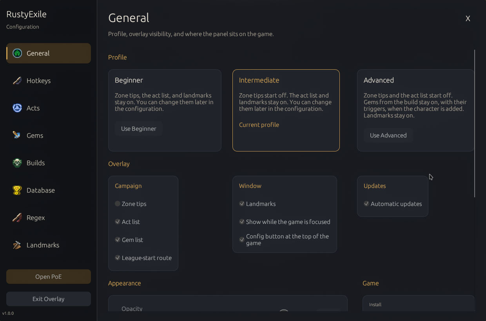
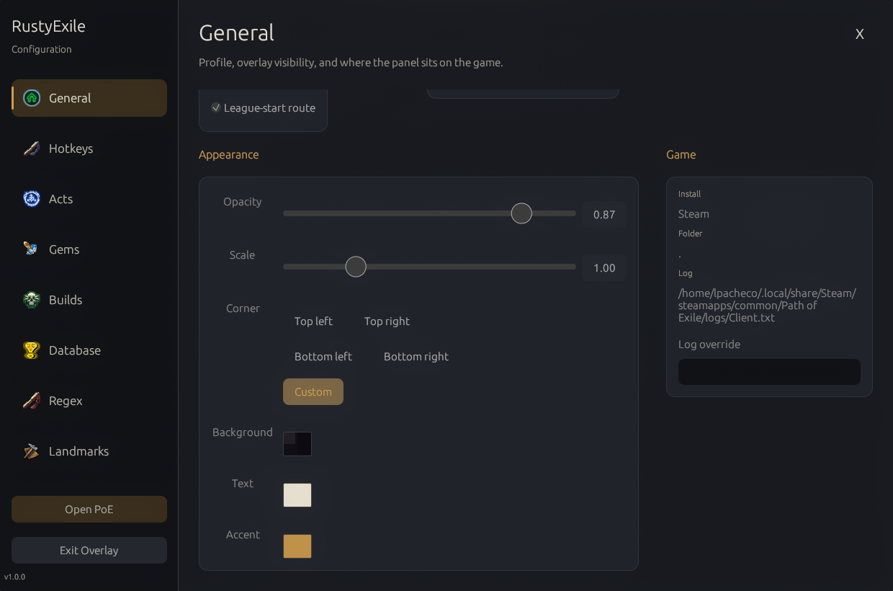
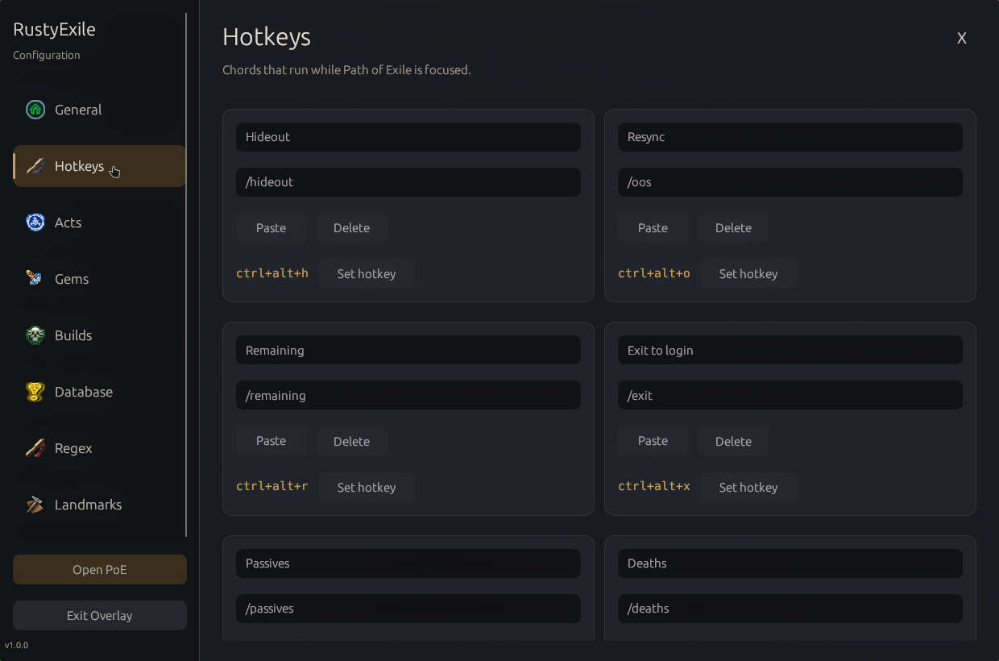
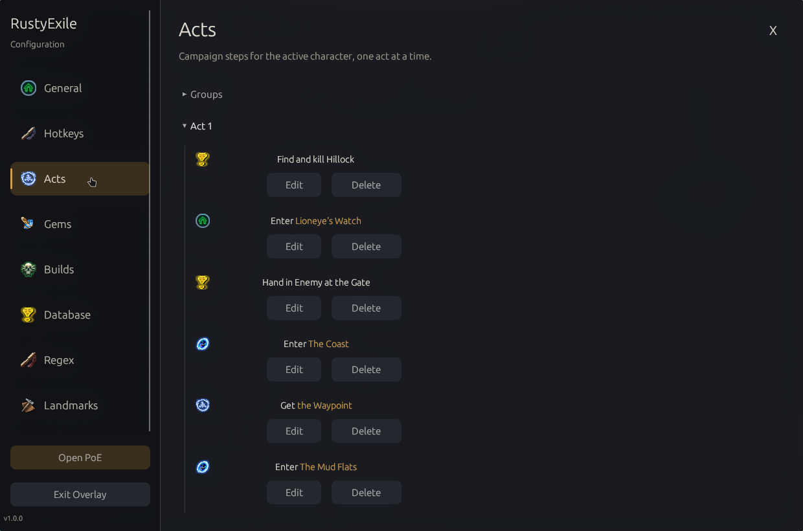
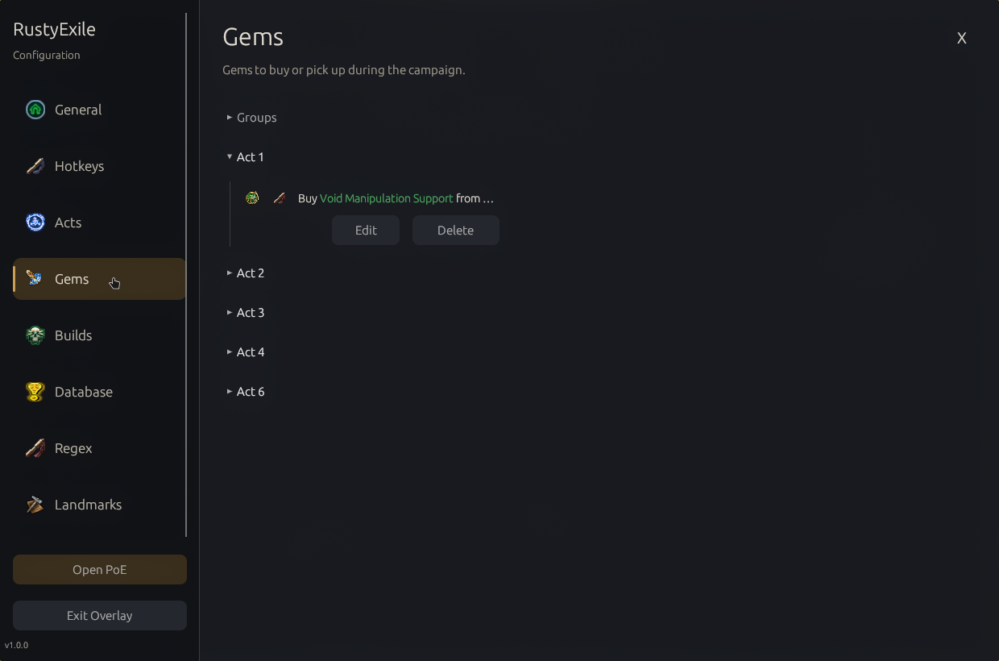
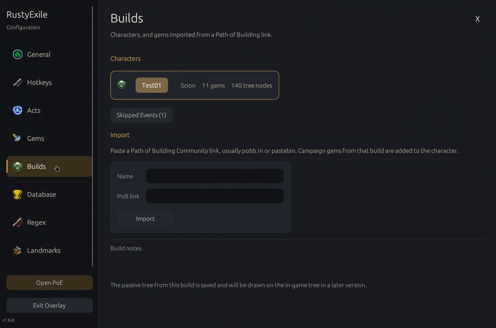
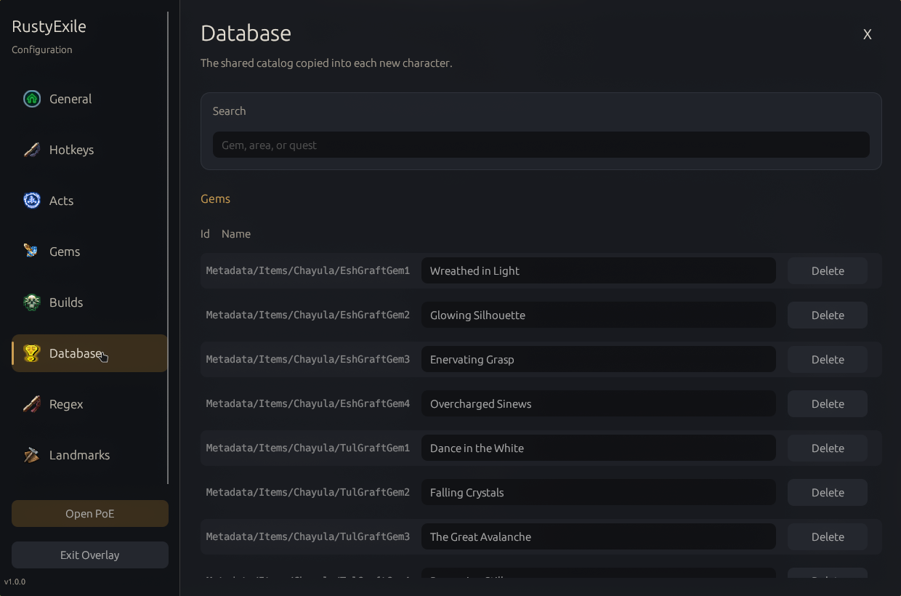
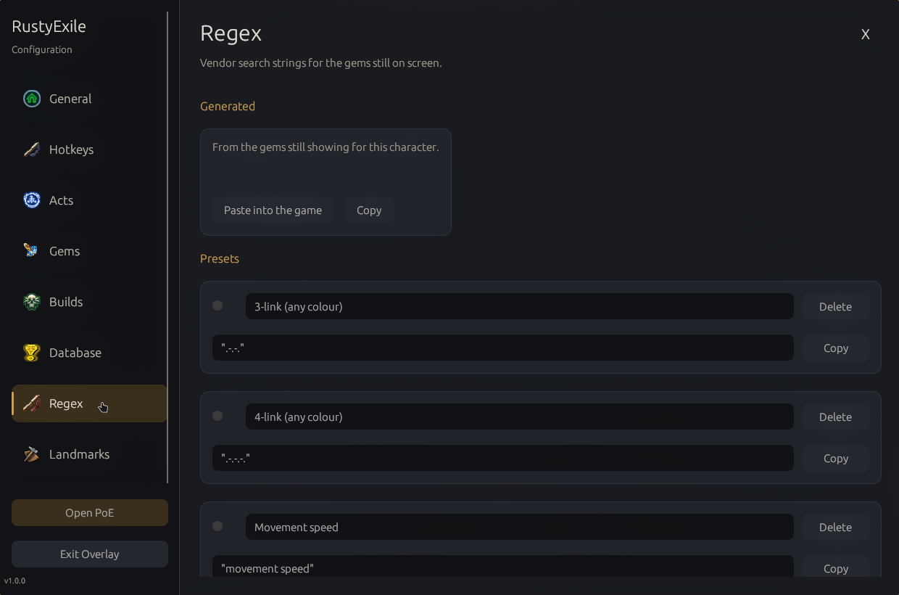
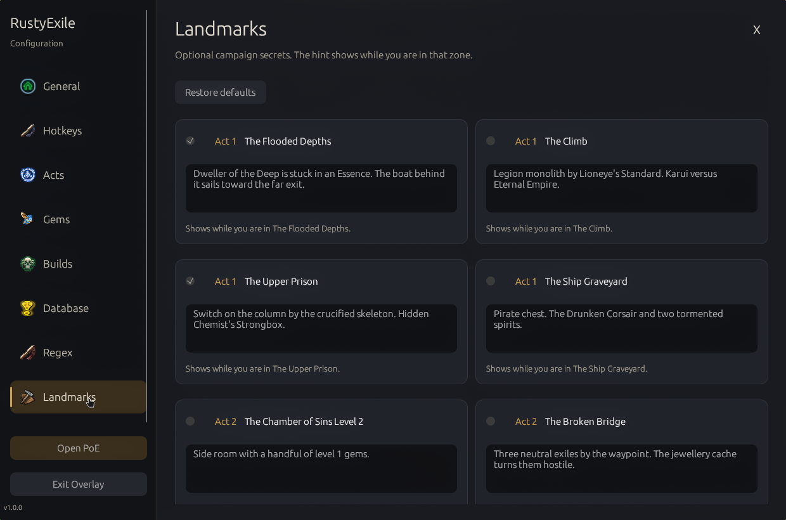

# RustyExile

Path of Exile 1 campaign overlay for Hyprland and Windows. It follows the game window, stays click-through, and shows the act, gem, and landmark steps for the zone you just entered. It does not read game memory. It tails `logs/Client.txt`.

I am a senior developer. RustyExile was developed with the assistance of an LLM.

This is a fan tool. It is not affiliated with or endorsed by Grinding Gear Games.

## Screenshots

<table>
<tr>
<td><br>General, top</td>
<td><br>General, bottom</td>
<td><br>Hotkeys</td>
</tr>
<tr>
<td><br>Acts</td>
<td><br>Gems</td>
<td><br>Builds</td>
</tr>
<tr>
<td><br>Database</td>
<td><br>Regex</td>
<td><br>Landmarks</td>
</tr>
</table>

## Install

Clone the repository, open that folder, and run the installer for your system. Each script asks before it installs anything. It installs Rust when Rust is missing, installs the libraries the build needs, and builds the release program. The first build can take several minutes.

Start Path of Exile, then start RustyExile.

### Linux

```bash
./installLinux.sh
```

Works on Arch, Debian, Ubuntu, Fedora, and openSUSE. The script can add an app-menu shortcut and add your user to the `input` group so Ctrl+Alt+click can see the keyboard without taking it from the game. Log out and back in after joining that group. The other hotkeys still work through the desktop shortcut portal if you skip it.

The program is `target/release/RustyExile`.

### Windows

For a normal install, download `RustyExile-windows-x86_64-setup.exe` from the latest [GitHub release](https://github.com/atlazlp/RustyExile/releases/latest), run it, and start RustyExile from the Start Menu.

To build from source, open Git Bash in the repository folder and run:

```bash
bash installWindows.bash
```

That script can install the Microsoft C++ build tools when the MSVC toolchain needs them, and it can add a Start Menu shortcut. To also build the Windows setup program after a source build, install [Inno Setup](https://jrsoftware.org/isinfo.php) and run:

```powershell
powershell -ExecutionPolicy Bypass -File packaging/windows/build-installer.ps1
```

The program is `target\release\RustyExile.exe`. The setup program is `dist\RustyExile-windows-x86_64-setup.exe`.

## First run

The first window asks you to start as Beginner, Intermediate, or Advanced.

- Beginner keeps zone tips, the act list, and landmarks on.
- Intermediate turns tips off. The act list and landmarks stay on.
- Advanced turns tips and the act list off. Gems from the build stay on. Landmarks stay on.

Every switch can be changed later. Open configuration from the button at the top center of the game window, or with Ctrl+Shift+O. Close that window with its close button.

The Twilight Strand starts with killing Hillock. Each later zone shows the step or gem that starts there, and hides it when the next route zone is entered. On the Builds tab, Re-level clears that character's progress and puts the overlay back on the Twilight Strand, with Hillock as the first mission. Delete removes the character. Ctrl+Alt+click clears a line early. The game log does not record quest turn-ins, gem pickups, or vendor buys. Passive-tree specs imported from Path of Building are saved and are not drawn yet.

## Hotkeys

| Action | Default |
| --- | --- |
| Toggle the overlay | Ctrl+Shift+H |
| Open configuration | Ctrl+Shift+O |
| Paste the vendor regex | Ctrl+Shift+V |
| Clear a task | Ctrl+Alt+click |

On Hyprland, the paste hotkey copies the regex and sends Ctrl+A, Ctrl+V to the game window. Chat hotkeys such as Hideout paste the whole command into chat and then remove that clipboard entry.

## Updates

Automatic updates are on by default. RustyExile checks the latest GitHub release, replaces the program and its shipped assets, and keeps your settings and character builds. Turn this off under General. Check for updates then appears at the bottom of the side menu.

A release is published by running the Release workflow from the Actions tab. It builds Linux and Windows from the version in `Cargo.toml`, tags `v` plus that version, and publishes the zip archives plus the Windows setup program.

## Credits

Thank you to [Grinding Gear Games](https://www.grindinggear.com/) for making [Path of Exile](https://www.pathofexile.com/).

These projects shaped how the overlay follows the campaign:

- [Exile-UI](https://github.com/Lailloken/Exile-UI), for a campaign overlay that advances as you enter each zone.
- [poe-leveling](https://poe-leveling.com/), for the leveling notes this route is built around.
- [Path of Exile Wiki](https://www.poewiki.net/), for the campaign reference, including the [landmarks guide](https://www.poewiki.net/wiki/Guide:Campaign_landmarks).
- [Path of Building Community](https://github.com/PathOfBuildingCommunity/PathOfBuilding), for the passive-tree imports.

Asset licenses are in `NOTICE`.
